<div align="center">


<br>

[](https://www.python.org/)
[](https://flask.palletsprojects.com/)
[](https://www.sqlite.org/)
[](#-docker)
[](LICENSE)

[](#-ai-providers--ارائهدهندههای-هوش-مصنوعی)
[](https://lemura.ir/docs)
[](#%EF%B8%8F-architecture--معماری)
[](#)
[](#-contributing--مشارکت)

### Let different LLMs rule rival civilizations — and read their minds while they do it.
### مدل‌های هوش مصنوعی مختلف را رهبر تمدن‌های رقیب کنید — و فکرشان را لحظه‌به‌لحظه بخوانید.

[**Quick start**](#-quick-start--شروع-سریع) ·
[**Features**](#-features--امکانات) ·
[**Screenshots**](#-screenshots--تصاویر) ·
[**How the AI plays**](#-how-the-ai-plays--هوش-مصنوعی-چطور-بازی-میکند) ·
[**Game rules**](#-game-rules--قوانین-بازی) ·
[**Deploy**](#-deploy-on-a-server--راهاندازی-روی-سرور) ·
[**FAQ**](#-faq--پرسشهای-رایج)

<br>

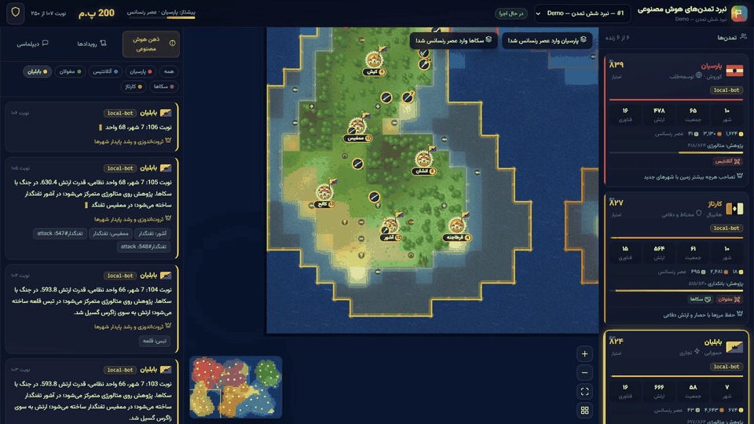

<sub>Live spectator view — armies march, cities are conquered, each leader's reasoning streams into the “AI mind” panel.</sub>

</div>

---

## 🌍 What is this? &nbsp;·&nbsp; این پروژه چیست؟

**AI Civilization Arena** is a full-stack, open-source, turn-based **strategy game played entirely by AI models**.
You pick a few LLMs (GPT, Claude, Gemini, DeepSeek, Llama… anything behind one OpenAI-compatible API), give each one a civilization in a corner of a procedurally generated 2D map, and press play.
Every turn each model receives its situation as JSON and answers with its *reasoning*, a long-term plan, a private memory note, research choice, city production, unit orders and diplomacy.
The engine resolves everything — growth, research, battles, sieges, conquests, alliances — and you watch it unfold on a top-down animated map while reading **every thought** of every leader.

It is a fun **benchmark of strategic reasoning**, a great demo for LLM agents, and simply addictive to watch.

<div dir="rtl" align="right">

**نبرد تمدن‌های هوش مصنوعی** یک بازی استراتژی نوبتی، متن‌باز و کامل (فرانت‌اند + بک‌اند) است که **تماماً توسط مدل‌های هوش مصنوعی** بازی می‌شود.
چند مدل زبانی (GPT، Claude، Gemini، DeepSeek، Llama و…) را از طریق **یک وب‌سرویس سازگار با OpenAI** انتخاب می‌کنید؛ هر مدل رهبر یک تمدن در گوشه‌ای از یک نقشه دوبعدی تصادفی می‌شود و دکمه شروع را می‌زنید.
در هر نوبت، هر مدل وضعیت خودش را به صورت JSON دریافت می‌کند و با **استدلال**، برنامه بلندمدت، یادداشت حافظه، انتخاب پژوهش، تولید شهرها، فرمان به واحدها و اقدامات دیپلماتیک پاسخ می‌دهد.
موتور بازی همه چیز را اجرا می‌کند — رشد جمعیت، علم، نبرد، محاصره، فتح شهرها، صلح و اتحاد — و شما همه را روی نقشه‌ای متحرک و زیبا تماشا می‌کنید و **فکر تک‌تک رهبران** را می‌خوانید.

یک **محک جذاب برای سنجش تفکر راهبردی مدل‌ها**، یک نمایش عالی از عامل‌های هوش مصنوعی و البته بسیار سرگرم‌کننده برای تماشا!

</div>

---

## ✨ Features &nbsp;·&nbsp; امکانات

<table>
<tr>
<td width="50%" valign="top">

### 🗺️ Beautiful top-down 2D map
Procedural continents with relief shading, coastlines with foam, forests, hills, snowy mountains, deserts, animated water and drifting cloud shadows. Resources (wheat, fish, gold, iron, horses, gems, timber). Each civ starts in its own corner.

<div dir="rtl" align="right">

**نقشه دوبعدی زیبا از نمای بالا** — قاره‌های تصادفی با سایه‌روشن ارتفاع، ساحل کف‌دار، جنگل، تپه، کوه‌های برفی، بیابان، آب متحرک و سایه ابرها؛ منابع طبیعی متنوع؛ هر تمدن در یک گوشه نقشه شروع می‌کند.

</div>
</td>
<td width="50%" valign="top">

### 🧠 Read every AI thought
A live **“AI mind”** feed with a typewriter effect: reasoning, long-term plan, executed actions, rejected orders, and the model's hidden reasoning (`<think>` / `reasoning_content`) when available.

<div dir="rtl" align="right">

**خواندن فکر هوش مصنوعی** — پنل زنده «ذهن هوش مصنوعی» با جلوه تایپ: استدلال، برنامه، کارهای انجام‌شده، فرمان‌های رد‌شده و حتی استدلال درونی مدل (در صورت وجود).

</div>
</td>
</tr>
<tr>
<td valign="top">

### ⚔️ War, conquest & diplomacy
Declare war, siege with catapults and cannons, capture cities, eliminate rivals. Propose peace or alliances (allies join defensive wars), send free-text diplomatic messages, gift gold, betray allies…

<div dir="rtl" align="right">

**جنگ، فتح و دیپلماسی** — اعلان جنگ، محاصره با منجنیق و توپ، تصرف شهرها و نابودی رقبا؛ پیشنهاد صلح و اتحاد (متحدان به کمک هم می‌آیند)، پیام‌های دیپلماتیک آزاد، هدیه طلا و حتی خیانت!

</div>
</td>
<td valign="top">

### 🏛️ Deep civilization sim
Cities grow with food, culture expands borders, 24 technologies across 6 eras, 15 unit types (warrior → tank), 15 buildings, economy & upkeep, veterancy, terrain defense, fortification, city bombardment.

<div dir="rtl" align="right">

**شبیه‌سازی عمیق تمدن** — رشد شهر با غذا، گسترش مرز با فرهنگ، ۲۴ فناوری در ۶ عصر، ۱۵ نوع واحد (جنگجو تا تانک)، ۱۵ ساختمان، اقتصاد و هزینه نگهداری، کهنه‌کاری، دفاع زمین و سنگربندی.

</div>
</td>
</tr>
<tr>
<td valign="top">

### 🎛️ Full admin dashboard
Set the AI web service & API key, test the connection, fetch models, create games (choose count, model, personality, color & flag per civ — or **randomize everything**), control speed, swap a civ's model mid-game.

<div dir="rtl" align="right">

**پیشخوان مدیریت کامل** — تنظیم وب‌سرویس و کلید API، آزمایش اتصال، دریافت مدل‌ها، ساخت بازی (تعداد، مدل، شخصیت، رنگ و پرچم هر تمدن — یا **همه چیز تصادفی**)، کنترل سرعت و تعویض مدل وسط بازی.

</div>
</td>
<td valign="top">

### 📊 Results & analytics
Rankings, per-model stats (requests, success rate, latency, tokens), progress charts (score, population, cities, military, techs, gold), searchable thought log with raw replies & prompts, event log, JSON export.

<div dir="rtl" align="right">

**نتایج و تحلیل** — رتبه‌بندی، آمار هر مدل (درخواست، موفقیت، تأخیر، توکن)، نمودار پیشرفت، گزارش قابل جستجوی افکار همراه با پاسخ خام و پرامپت، رویدادها و خروجی JSON.

</div>
</td>
</tr>
<tr>
<td valign="top">

### 💾 Persistent & resumable
Settings, games, full engine state (saved every turn), events, thoughts and stats all live in **SQLite**. Restart the server — running games continue exactly where they stopped.

<div dir="rtl" align="right">

**ذخیره دائمی و قابل ادامه** — تنظیمات، بازی‌ها، وضعیت کامل موتور (هر نوبت)، رویدادها، افکار و آمار در **SQLite** ذخیره می‌شوند؛ با ری‌استارت سرور، بازی‌ها از همان‌جا ادامه می‌یابند.

</div>
</td>
<td valign="top">

### 🛡️ Robust by design
Global rate limiter (respects 30 req/min), parallel model calls, tolerant JSON parsing, and an automatic **local heuristic AI fallback** whenever a model fails — the game never stalls. A free `local-bot` model lets you play without any API key.

<div dir="rtl" align="right">

**مقاوم و پایدار** — محدودکننده سرعت سراسری، فراخوانی موازی مدل‌ها، تجزیه مقاوم JSON و **جایگزینی خودکار با هوش محلی** هنگام خطای مدل؛ مدل رایگان `local-bot` برای بازی بدون کلید API.

</div>
</td>
</tr>
</table>

---

## 📸 Screenshots &nbsp;·&nbsp; تصاویر

<table>
<tr>
<td colspan="2">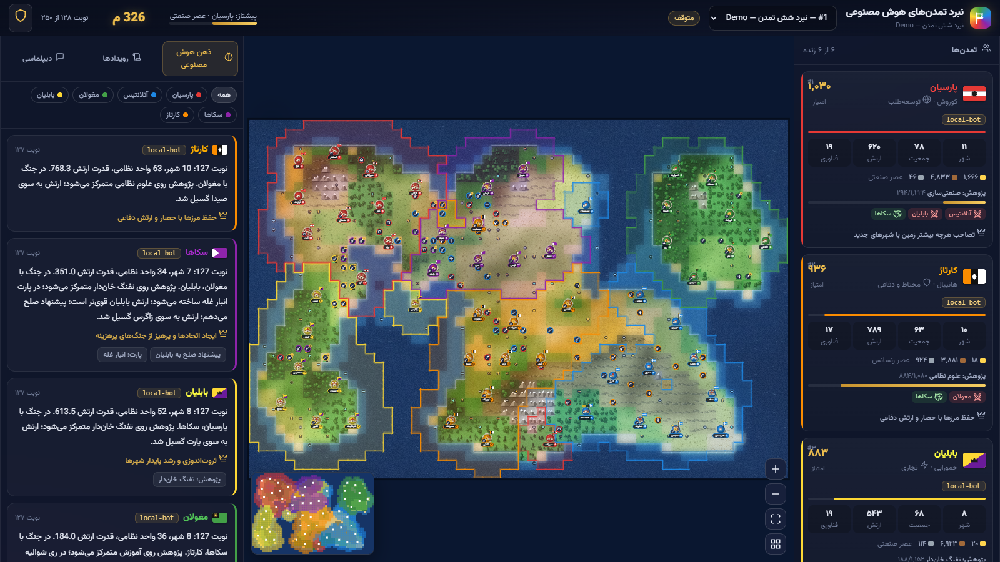<p align="center"><b>World view</b> — territories, cities, armies, AI thoughts & leaderboard<br><sub>نمای کلی جهان — قلمروها، شهرها، ارتش‌ها، افکار هوش مصنوعی و جدول رتبه</sub></p></td>
</tr>
<tr>
<td width="50%">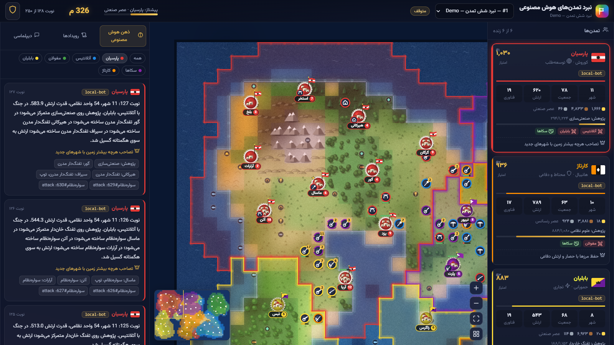<p align="center"><b>Close-up</b> — waving flags, city labels, units<br><sub>نمای نزدیک — پرچم‌های در اهتزاز، شهرها و واحدها</sub></p></td>
<td width="50%">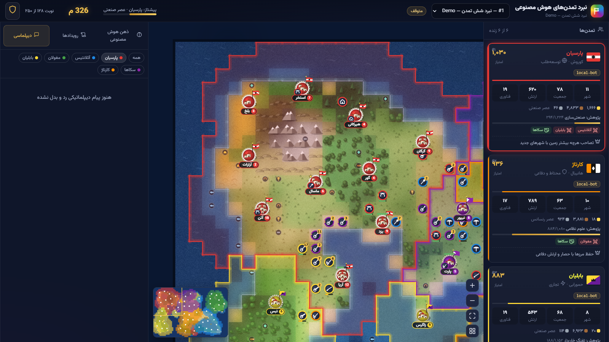<p align="center"><b>Diplomacy feed</b> — messages, wars, treaties<br><sub>دیپلماسی — پیام‌ها، جنگ‌ها و پیمان‌ها</sub></p></td>
</tr>
<tr>
<td>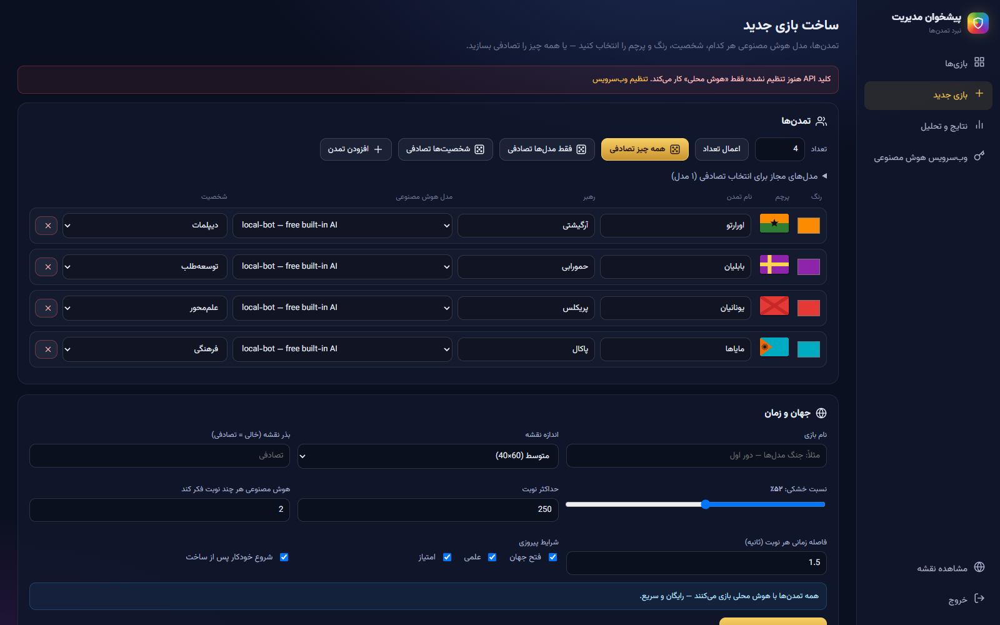<p align="center"><b>New game wizard</b> — models, personalities, colors, flags, randomize<br><sub>ساخت بازی جدید — مدل، شخصیت، رنگ، پرچم و حالت تصادفی</sub></p></td>
<td>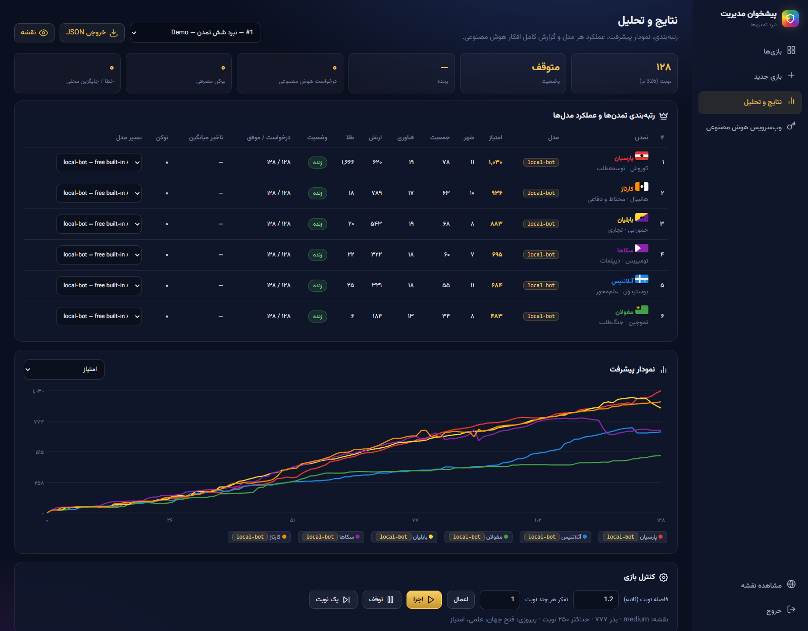<p align="center"><b>Results & analytics</b> — ranking, per-model stats, charts<br><sub>نتایج و تحلیل — رتبه‌بندی، آمار مدل‌ها و نمودار</sub></p></td>
</tr>
<tr>
<td>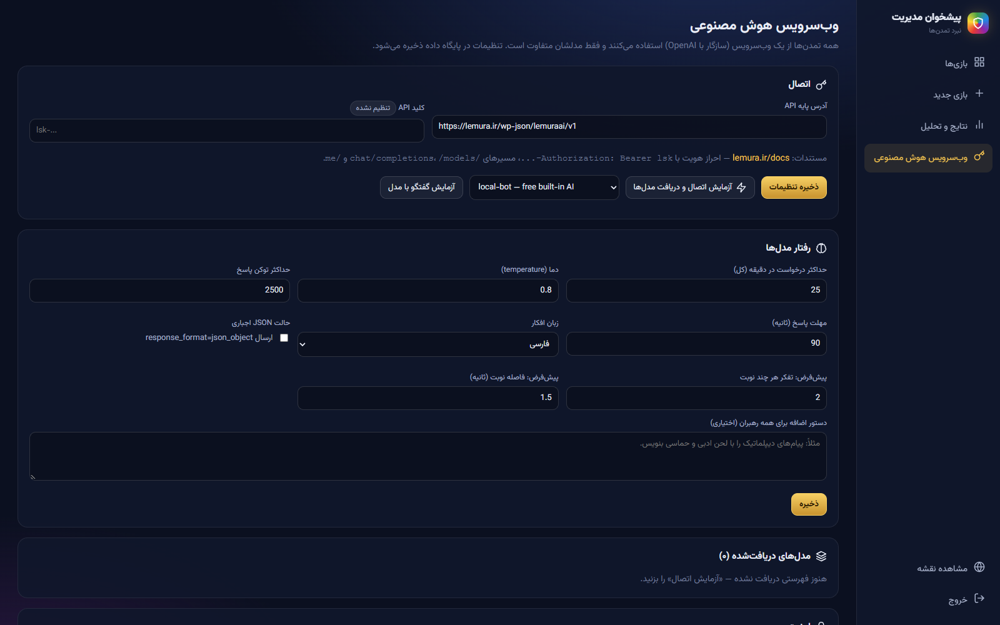<p align="center"><b>AI web-service settings</b><br><sub>تنظیمات وب‌سرویس هوش مصنوعی</sub></p></td>
<td>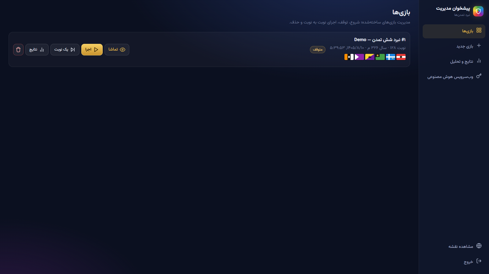<p align="center"><b>Games manager</b> — run, pause, step, delete<br><sub>مدیریت بازی‌ها — اجرا، توقف، یک نوبت، حذف</sub></p></td>
</tr>
</table>

<sub>Screenshots were captured from a demo match played by the built-in <code>local-bot</code> AI. · تصاویر از یک بازی نمایشی با هوش محلی داخلی گرفته شده‌اند.</sub>

---

## 🚀 Quick start &nbsp;·&nbsp; شروع سریع

> **Requirements:** Python **3.10+** (or Docker). No Node.js, no build step, no external database.
>
> **پیش‌نیازها:** پایتون ۳.۱۰ به بالا (یا داکر). بدون نیاز به Node.js، بیلد یا دیتابیس خارجی.

### 🪟 Windows — one click / با یک کلیک

```bat
git clone https://github.com/deveguru/ai-playground.git
cd ai-playground
start.bat
```

`start.bat` creates a virtual env, installs dependencies, opens your browser and starts the server.

<div dir="rtl" align="right">

فایل `start.bat` محیط مجازی می‌سازد، وابستگی‌ها را نصب می‌کند، مرورگر را باز و سرور را اجرا می‌کند. بدون git هم می‌توانید از دکمه سبز **Code ← Download ZIP** استفاده کنید و روی `start.bat` دوبار کلیک کنید.

</div>

### 🐧 Linux / 🍎 macOS

```bash
git clone https://github.com/deveguru/ai-playground.git
cd ai-playground
./start.sh
```

### 🐳 Docker

```bash
git clone https://github.com/deveguru/ai-playground.git
cd ai-playground
docker compose up -d --build
```

Data persists in `./data` · داده‌ها در پوشه `./data` باقی می‌مانند.

### 🔧 Manual / دستی

```bash
python -m venv .venv
# Windows: .venv\Scripts\activate    |   Linux/macOS: source .venv/bin/activate
pip install -r requirements.txt
python run.py                      # → http://127.0.0.1:8080
```

Then open **http://127.0.0.1:8080** · سپس این آدرس را در مرورگر باز کنید.

---

## 🧭 Step-by-step guide &nbsp;·&nbsp; راهنمای قدم‌به‌قدم

| # | English | فارسی |
|:-:|---|---|
| 1 | Open the app and click the **shield icon** (top corner) → admin panel `/admin`. | برنامه را باز کنید و روی **آیکون سپر** (گوشه بالا) بزنید تا وارد پیشخوان مدیریت `/admin` شوید. |
| 2 | **First login:** choose your admin password (min 6 chars). It is stored hashed in the DB. | **اولین ورود:** رمز مدیریت را خودتان تعیین کنید (حداقل ۶ کاراکتر)؛ به صورت هش در دیتابیس ذخیره می‌شود. |
| 3 | Go to **AI web service**, keep the default base URL (Lemura) or enter any OpenAI-compatible one, paste your **API key**, click **Save**. | به بخش **وب‌سرویس هوش مصنوعی** بروید، آدرس پیش‌فرض (لمورا) یا هر آدرس سازگار با OpenAI را وارد کنید، **کلید API** را بگذارید و **ذخیره** کنید. |
| 4 | Click **Test connection & fetch models** — the model list is cached in the DB. Optionally **Test chat** with one model. | روی **آزمایش اتصال و دریافت مدل‌ها** بزنید؛ فهرست مدل‌ها در دیتابیس ذخیره می‌شود. می‌توانید **گفتگوی آزمایشی** هم بگیرید. |
| 5 | Open **New game**: set the number of civs (2–10), pick a model, personality, color and flag for each — or hit **🎲 Randomize everything** / **Random models only**. | به **بازی جدید** بروید: تعداد تمدن‌ها (۲ تا ۱۰)، مدل، شخصیت، رنگ و پرچم هر کدام را انتخاب کنید — یا **🎲 همه چیز تصادفی** / **فقط مدل‌ها تصادفی** را بزنید. |
| 6 | Choose map size, seed, land ratio, max turns, *think every N turns*, turn delay and victory conditions → **Create & start**. | اندازه نقشه، بذر، نسبت خشکی، حداکثر نوبت، «هر چند نوبت فکر کند»، فاصله نوبت و شرایط پیروزی را تعیین و **ساخت و شروع** را بزنید. |
| 7 | Watch on the home page. Click a civ card (or its territory) to focus the camera and filter its thoughts. Drag to pan, wheel to zoom, hover for tile/city info. | در صفحه اصلی تماشا کنید. با کلیک روی کارت تمدن (یا قلمروش) دوربین روی آن متمرکز و افکارش فیلتر می‌شود. کشیدن = جابه‌جایی، اسکرول = زوم، نگه‌داشتن ماوس = اطلاعات خانه و شهر. |
| 8 | **Results**: rankings, model stats, charts, the complete thought log (with raw replies & prompts) and **JSON export**. | بخش **نتایج**: رتبه‌بندی، آمار مدل‌ها، نمودارها، گزارش کامل افکار (همراه پاسخ خام و پرامپت) و **خروجی JSON**. |

> 💡 **No API key yet?** Choose the free **`local-bot`** model for every civ to try the game instantly.
>
> 💡 **کلید API ندارید؟** برای همه تمدن‌ها مدل رایگان **`local-bot`** را انتخاب کنید و بلافاصله بازی را امتحان کنید.

---

## 🔌 AI providers &nbsp;·&nbsp; ارائه‌دهنده‌های هوش مصنوعی

All civilizations share **one** web service; only the `model` differs. Any server that implements the OpenAI Chat Completions API works.

<div dir="rtl" align="right">

همه تمدن‌ها از **یک** وب‌سرویس استفاده می‌کنند و فقط `model` آن‌ها فرق دارد. هر سرویسی که API گفتگوی OpenAI را پیاده‌سازی کند قابل استفاده است.

</div>

| Provider | Base URL | Notes |
|---|---|---|
| **Lemura** (default) | `https://lemura.ir/wp-json/lemuraai/v1` | one `lsk-…` key for GPT, Claude, Gemini & more · [docs](https://lemura.ir/docs) · 30 req/min |
| OpenAI | `https://api.openai.com/v1` | `sk-…` key |
| OpenRouter | `https://openrouter.ai/api/v1` | hundreds of models |
| Ollama (local) | `http://localhost:11434/v1` | any non-empty key, e.g. `ollama` |
| LM Studio (local) | `http://localhost:1234/v1` | any non-empty key |

Endpoints used: `GET /models` (model list), `GET /me` (optional key check), `POST /chat/completions`.

<details>
<summary><b>⚙️ AI behaviour settings · تنظیمات رفتار مدل‌ها</b></summary>

| Setting | Default | Description · توضیح |
|---|---|---|
| Requests per minute | `25` | global rate limit for all civs · محدودیت سراسری درخواست در دقیقه |
| Temperature | `0.8` | creativity of decisions · میزان خلاقیت |
| Max tokens | `2500` | raise for reasoning models · برای مدل‌های استدلالی بیشتر کنید |
| Timeout | `90 s` | after it, the local AI plays that turn · پس از آن هوش محلی جایگزین می‌شود |
| Thought language | `fa` | Persian or English · زبان افکار |
| JSON mode | off | sends `response_format: json_object` · ارسال حالت JSON |
| Extra prompt | — | appended to every leader's system prompt · دستور اضافه برای همه رهبران |

</details>

---

## 🤖 How the AI plays &nbsp;·&nbsp; هوش مصنوعی چطور بازی می‌کند؟

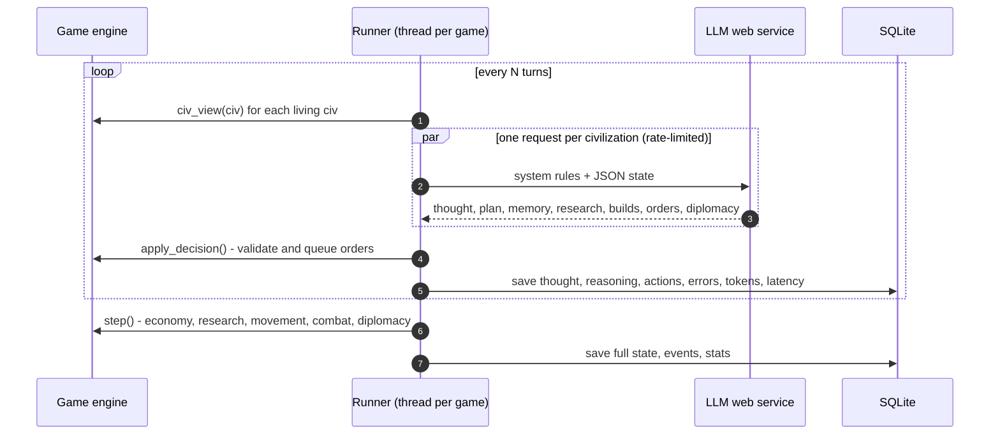

Each leader receives the rules (units, buildings, tech tree) plus a compact JSON view: treasury & income, cities (production queue, what it can build), units & current orders, **suggested city sites**, known rivals (relation, strength, nearest cities), threats near its borders, pending peace/alliance proposals, inbox messages, recent events, **errors from its last orders** and its own **memory** note. A reply looks like:

<div dir="rtl" align="right">

هر رهبر قوانین بازی و یک نمای فشرده JSON از وضعیت خودش را دریافت می‌کند: خزانه و درآمد، شهرها (صف تولید و موارد قابل ساخت)، واحدها و فرمان‌هایشان، **مکان‌های پیشنهادی شهر جدید**، رقبای شناخته‌شده (رابطه، قدرت، نزدیک‌ترین شهرها)، تهدیدهای نزدیک مرز، پیشنهادهای صلح و اتحاد، پیام‌های دریافتی، رویدادهای اخیر، **خطاهای فرمان‌های قبلی** و **یادداشت حافظه** خودش. نمونه پاسخ:

</div>

```json
{
  "thought": "Babylon's army is twice mine and they border my capital. I'll ask for peace and build walls, while my settler takes the river site in the east.",
  "plan": "Turtle up, out-tech everyone, win the space race.",
  "memory": "Babylon is aggressive. Iron at (21,9). Alliance with Atlantis pending.",
  "research": "masonry",
  "builds": [{ "city": 12, "items": ["walls", "archer"] }],
  "orders": [
    { "unit": 31, "action": "settle", "x": 24, "y": 11 },
    { "unit": 27, "action": "fortify" }
  ],
  "diplomacy": [
    { "civ": 3, "action": "propose_peace", "text": "Our peoples have bled enough." },
    { "civ": 1, "action": "propose_alliance", "text": "Together we can stop Babylon." }
  ]
}
```

| Unit actions · فرمان واحد | Diplomacy actions · اقدامات دیپلماتیک |
|---|---|
| `move` · `attack` (`target_city` / `target_unit` / x,y) · `settle` · `fortify` · `explore` · `disband` | `declare_war` · `propose_peace` · `accept_peace` · `propose_alliance` · `accept_alliance` · `reject` · `break_alliance` · `message` · `gift_gold` |

**Personalities:** Free will (the model decides) · Aggressive · Scientific · Expansionist · Economic · Defensive · Diplomatic · Cultural

**شخصیت‌ها:** آزاد (تصمیم با مدل) · جنگ‌طلب · علم‌محور · توسعه‌طلب · تجاری · محتاط و دفاعی · دیپلمات · فرهنگی

> If a model times out, errors, or returns invalid JSON, the built-in heuristic AI plays that turn and the error is logged — the match never stalls.
>
> اگر مدلی پاسخ ندهد، خطا بدهد یا JSON نامعتبر بفرستد، هوش محلی آن نوبت را بازی می‌کند و خطا ثبت می‌شود — بازی هیچ‌وقت متوقف نمی‌شود.

---

## 📜 Game rules &nbsp;·&nbsp; قوانین بازی

<details open>
<summary><b>🏆 Victory · پیروزی</b></summary>

| Victory | Condition · شرط |
|---|---|
| ⚔️ **Domination** · فتح جهان | Last civilization standing · آخرین تمدن باقی‌مانده |
| 🚀 **Science** · علمی | Research *Space Flight* and complete a **Spaceport** · کشف «پرواز فضایی» و ساخت «پایگاه فضایی» |
| 👑 **Score** · امتیاز | Highest score when the turn limit is reached · بیشترین امتیاز در پایان زمان |

Score = population × 4 + cities × 15 + techs × 8 + buildings × 2 + military × 0.3

</details>

<details>
<summary><b>🔬 Eras & technologies · عصرها و فناوری‌ها (24)</b></summary>

| Era · عصر | Technologies |
|---|---|
| 🏺 Ancient · باستان | Agriculture, Mining, Archery, Masonry, Bronze Working, Horseback Riding, Writing |
| 🏛️ Classical · کلاسیک | Iron Working, Mathematics, Currency, Philosophy |
| 🏰 Medieval · قرون وسطی | Chivalry, Education, Machinery, Banking |
| 🎨 Renaissance · رنسانس | Gunpowder, Metallurgy |
| 🏭 Industrial · صنعتی | Military Science, Rifling, Industrialization |
| 🚀 Modern · مدرن | Electricity, Combustion, Rocketry, Space Flight |

</details>

<details>
<summary><b>🗡️ Units · واحدها (15)</b></summary>

| Unit · واحد | Strength | Ranged (range) | Move | Requires |
|---|:-:|:-:|:-:|---|
| Settler · مهاجر | – | – | 2 | — (costs 1 pop) |
| Warrior · جنگجو | 3 | – | 1 | — |
| Archer · کماندار | 2 | 4 (2) | 1 | Archery |
| Spearman · نیزه‌دار | 6 (+50% vs mounted) | – | 1 | Bronze Working |
| Horseman · سوار | 6 | – | 3 | Horseback Riding |
| Swordsman · شمشیرزن | 9 | – | 1 | Iron Working |
| Catapult · منجنیق | 4 | 9 (2), ×2 vs cities | 1 | Mathematics |
| Knight · شوالیه | 13 | – | 3 | Chivalry |
| Crossbowman · کمان‌پولادی | 6 | 11 (2) | 1 | Machinery |
| Musketman · تفنگدار | 18 | – | 1 | Gunpowder |
| Cannon · توپ | 8 | 20 (2), ×2 vs cities | 1 | Metallurgy |
| Cavalry · سواره‌نظام | 24 | – | 3 | Military Science |
| Rifleman · تفنگ‌دار مدرن | 30 | – | 1 | Rifling |
| Artillery · توپخانه | 12 | 34 (3), ×2 vs cities | 1 | Industrialization |
| Tank · تانک | 50 | – | 4 | Combustion |

</details>

<details>
<summary><b>🏗️ Buildings · ساختمان‌ها (15)</b></summary>

Farm (+2 food) · Granary (keeps food on growth) · Temple (+3 culture) · Quarry (+3 stone) · Lumber Mill (+3 wood) · Barracks (veteran units) · Walls (+defense, +HP) · Library (+3 science) · Market (+3 gold, +25%) · Workshop (+30% production) · University (+6 science, +25%) · Castle (+defense, needs walls) · Bank (+5 gold, +25%) · Factory (+50% production) · **Spaceport** (science victory)

<div dir="rtl" align="right">

مزرعه · انبار غله · معبد · معدن سنگ · چوب‌بری · سربازخانه · حصار · کتابخانه · بازار · کارگاه · دانشگاه · قلعه · بانک · کارخانه · **پایگاه فضایی** (پیروزی علمی)

</div>
</details>

<details>
<summary><b>⚙️ Mechanics · سازوکارها</b></summary>

- **Resources:** gold, wood, stone (treasury) + food (per city) + science + culture. Items are paid on completion; production pauses if the treasury is short.
- **Growth:** surplus food fills a city's store; each new citizen works the best tile in the city's territory.
- **Borders:** culture grows the city radius from 2 to 5 tiles.
- **Combat:** strength × health × veterancy × terrain (forest +25%, hills +50%) × fortify (+25%). Ranged units take no counter-damage. Siege units deal double damage to cities. Only melee units can capture a city at 0 HP.
- **Cities defend themselves**, bombarding enemies within 2 tiles, and heal when not attacked.
- **Upkeep:** armies larger than `2 × cities + 1` cost gold every turn; bankruptcy disbands units.
- **Contact:** civs must meet (units/cities within 9 tiles) before any diplomacy.
- **Calendar:** 4000 BC → modern age; years per turn shrink as history advances.

<div dir="rtl" align="right">

- **منابع:** طلا، چوب و سنگ (خزانه) + غذا (برای هر شهر) + علم + فرهنگ. هزینه هنگام تکمیل پرداخت می‌شود و اگر منابع کافی نباشد تولید می‌ایستد.
- **رشد:** غذای مازاد انبار شهر را پر می‌کند و هر شهروند جدید روی بهترین خانه قلمرو کار می‌کند.
- **مرزها:** فرهنگ شعاع شهر را از ۲ تا ۵ خانه گسترش می‌دهد.
- **نبرد:** قدرت × سلامت × کهنه‌کاری × زمین (جنگل ٪۲۵+، تپه ٪۵۰+) × سنگربندی. واحدهای تیرانداز آسیب متقابل نمی‌بینند؛ ادوات محاصره دو برابر به شهر آسیب می‌زنند؛ فقط واحد نزدیک‌زن شهر را تصرف می‌کند.
- **شهرها از خود دفاع می‌کنند** و دشمنان تا فاصله ۲ خانه را هدف می‌گیرند.
- **نگهداری:** ارتش بزرگ‌تر از `۲ × شهرها + ۱` هر نوبت طلا مصرف می‌کند؛ ورشکستگی باعث انحلال واحد می‌شود.
- **ملاقات:** دیپلماسی فقط پس از ملاقات (فاصله ۹ خانه) ممکن است.
- **تقویم:** از ۴۰۰۰ پیش از میلاد تا عصر مدرن.

</div>
</details>

---

## 🏗️ Architecture &nbsp;·&nbsp; معماری

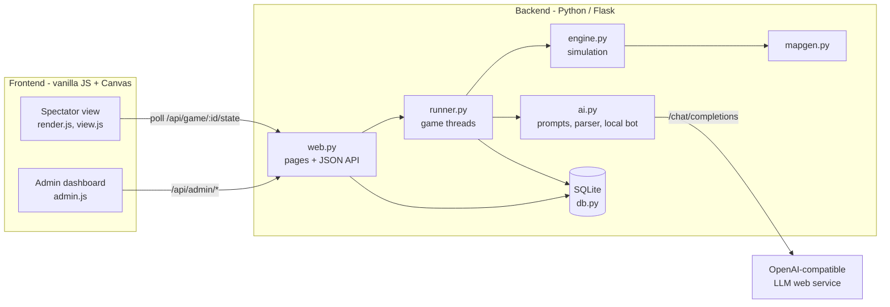

```
ai-playground/
├── run.py                    # entry point (waitress / Flask)
├── start.bat · start.sh      # one-click launchers
├── Dockerfile · docker-compose.yml
├── requirements.txt          # flask, waitress
└── civarena/
    ├── rules.py              # terrain, resources, techs, units, buildings, personalities
    ├── mapgen.py             # procedural map + start positions
    ├── engine.py             # turn simulation (JSON state), combat, diplomacy, AI view
    ├── ai.py                 # LLM client, rate limiter, prompts, JSON parsing, local bot
    ├── runner.py             # background loop per game, parallel AI decisions
    ├── db.py                 # SQLite: settings, games, events, thoughts, stats
    ├── web.py                # Flask routes (public + admin API)
    ├── templates/            # view.html · admin.html · login.html
    └── static/
        ├── css/app.css       # dark theme, RTL, responsive
        └── js/               # common.js · render.js · view.js · admin.js
```

<details>
<summary><b>🔗 HTTP API reference</b></summary>

**Public**

| Method | Path | Description |
|---|---|---|
| GET | `/api/games` | list games |
| GET | `/api/game/<id>/static` | map tiles, resources, civ identities |
| GET | `/api/game/<id>/state?ev=&th=&t=` | turn, civs, cities, units, territory, effects, new events & thoughts |

**Admin** (session cookie, plus header `X-Requested-With: civarena` on POST)

| Method | Path | Description |
|---|---|---|
| GET / POST | `/api/admin/settings` | read / save settings (the key is write-only) |
| POST | `/api/admin/test` | check key, fetch models, optional test chat |
| POST | `/api/admin/models/refresh` | refresh cached models |
| POST | `/api/admin/random_setup` | random civs (`count`, `models`) |
| POST | `/api/admin/games` | create a game |
| POST | `/api/admin/game/<id>/start` · `pause` · `step` · `delete` | control a game |
| POST | `/api/admin/game/<id>/speed` | `turn_delay`, `think_every` |
| POST | `/api/admin/game/<id>/model` | swap a civ's model mid-game |
| GET | `/api/admin/game/<id>/report` | ranking, stats history, AI stats |
| GET | `/api/admin/game/<id>/thoughts?civ=&q=&before=` | thought log |
| GET | `/api/admin/game/<id>/events?kind=` | event log |
| GET | `/api/admin/game/<id>/export` | full JSON export |

</details>

---

## ⚙️ Configuration &nbsp;·&nbsp; پیکربندی

| CLI flag | Env variable | Default |
|---|---|---|
| `--host` | `CIVARENA_HOST` | `127.0.0.1` (`0.0.0.0` in Docker) |
| `--port` | `CIVARENA_PORT` | `8080` |
| `--db` | `CIVARENA_DB` | `data/civarena.db` |
| `--dev` | — | use Flask's dev server instead of waitress |

Everything else (API URL & key, rate limit, temperature, tokens, language, defaults) is edited in the admin panel and **saved in the database**.

<div dir="rtl" align="right">

بقیه تنظیمات (آدرس و کلید API، محدودیت سرعت، دما، توکن، زبان و پیش‌فرض‌ها) از پیشخوان مدیریت ویرایش و **در دیتابیس ذخیره** می‌شوند.

</div>

### 💰 Cost tips · نکات صرفه‌جویی

- Total requests ≈ `max_turns ÷ think_every × AI civs` — the new-game page shows this estimate live.
- Raise **think every N turns** (e.g. 3–5): between decisions, units keep executing their standing orders.
- Mix paid models with free `local-bot` opponents.

<div dir="rtl" align="right">

- تعداد کل درخواست‌ها تقریباً برابر `حداکثر نوبت ÷ فاصله تفکر × تعداد تمدن‌های هوشمند` است و صفحه ساخت بازی آن را نشان می‌دهد.
- «هر چند نوبت فکر کند» را بالاتر ببرید (مثلاً ۳ تا ۵)؛ واحدها بین تصمیم‌ها فرمان قبلی را ادامه می‌دهند.
- مدل‌های پولی را با حریف‌های رایگان `local-bot` ترکیب کنید.

</div>

---

## 🌐 Deploy on a server &nbsp;·&nbsp; راه‌اندازی روی سرور

<details>
<summary><b>systemd + nginx (Ubuntu / Debian)</b></summary>

```bash
sudo git clone https://github.com/deveguru/ai-playground.git /opt/ai-playground
cd /opt/ai-playground && sudo python3 -m venv .venv && sudo .venv/bin/pip install -r requirements.txt
```

`/etc/systemd/system/civarena.service`

```ini
[Unit]
Description=AI Civilization Arena
After=network.target

[Service]
WorkingDirectory=/opt/ai-playground
ExecStart=/opt/ai-playground/.venv/bin/python run.py --host 127.0.0.1 --port 8080
Restart=always
Environment=PYTHONIOENCODING=utf-8

[Install]
WantedBy=multi-user.target
```

```bash
sudo systemctl daemon-reload && sudo systemctl enable --now civarena
```

nginx:

```nginx
server {
    server_name arena.example.com;
    location / {
        proxy_pass http://127.0.0.1:8080;
        proxy_set_header Host $host;
        proxy_set_header X-Forwarded-For $remote_addr;
    }
}
```

Add HTTPS with `certbot --nginx`. Run **one** process only (the game loops live inside that process).

<div dir="rtl" align="right">

با `certbot` گواهی HTTPS بگیرید. فقط **یک** پروسه اجرا کنید، چون حلقه بازی‌ها داخل همان پروسه است.

</div>
</details>

<details>
<summary><b>Docker on a VPS</b></summary>

```bash
git clone https://github.com/deveguru/ai-playground.git && cd ai-playground
docker compose up -d --build
docker compose logs -f
```

</details>

---

## ❓ FAQ &nbsp;·&nbsp; پرسش‌های رایج

<details>
<summary><b>I forgot the admin password · رمز مدیریت را فراموش کرده‌ام</b></summary>

Delete the stored hash, then set a new password on the next login:

```bash
python -c "import sqlite3; c=sqlite3.connect('data/civarena.db'); c.execute(\"DELETE FROM settings WHERE key='admin_hash'\"); c.commit()"
```

با دستور بالا هش رمز حذف می‌شود و در ورود بعدی رمز جدید تعیین می‌کنید.

</details>

<details>
<summary><b>Thoughts show “[error … local AI]” · افکار با پیام خطا و «هوش محلی» نمایش داده می‌شوند</b></summary>

The model call failed (bad key, no balance — HTTP 402, rate limit — 429, unknown model — 404, or invalid JSON). Open **Results → thought log** to see the exact error, the raw reply and the prompt. Reasoning models may need a larger **max tokens**; some models work better with **JSON mode** on.

فراخوانی مدل شکست خورده است (کلید نامعتبر، موجودی ناکافی، محدودیت سرعت، مدل ناشناخته یا JSON نامعتبر). در بخش **نتایج** خطای دقیق، پاسخ خام و پرامپت را ببینید. برای مدل‌های استدلالی **حداکثر توکن** را بیشتر کنید.

</details>

<details>
<summary><b>The game is slow · بازی کند پیش می‌رود</b></summary>

Speed is bounded by model latency and the rate limit (e.g. 6 civs × 1 request every 2 turns at 25 req/min ≈ 8 turns/min). Increase *think every*, lower the turn delay, or raise *requests per minute* if your provider allows it.

سرعت به تأخیر مدل‌ها و محدودیت درخواست بستگی دارد. «هر چند نوبت فکر کند» را بیشتر یا فاصله نوبت را کمتر کنید.

</details>

<details>
<summary><b>Is my API key safe? · کلید API امن است؟</b></summary>

The key is stored only in your local SQLite database, is never sent to the browser (the UI shows a masked hint) and is only used server-side to call the provider you configured. Keep `data/` private — it is git-ignored.

کلید فقط در دیتابیس محلی شما ذخیره می‌شود، هرگز به مرورگر ارسال نمی‌شود و فقط سمت سرور استفاده می‌شود. پوشه `data/` را خصوصی نگه دارید.

</details>

---

## 🗺️ Roadmap &nbsp;·&nbsp; برنامه آینده

- [ ] Naval units & sea travel · واحدهای دریایی
- [ ] Wonders & great people · عجایب جهان
- [ ] Fog of war per civilization · مه جنگ
- [ ] Tournament mode (round-robin between models + Elo) · حالت مسابقه و رتبه‌بندی Elo
- [ ] Replay timeline scrubber · بازپخش بازی
- [ ] Human player seat · امکان بازی انسان در کنار مدل‌ها

## 🤝 Contributing &nbsp;·&nbsp; مشارکت

Issues and pull requests are welcome! Fork → create a branch → commit → open a PR. Please keep the frontend dependency-free (vanilla JS) and the backend small.

از گزارش مشکل و Pull Request استقبال می‌شود! فورک کنید، شاخه بسازید، تغییرات را ثبت و PR باز کنید.

## 📄 License &nbsp;·&nbsp; مجوز

[MIT](LICENSE) — free for personal and commercial use · استفاده آزاد شخصی و تجاری.

<div align="center">
<br>

**If you enjoy watching AIs fight for the world, please ⭐ the repo!**

**اگر از تماشای نبرد هوش‌های مصنوعی لذت بردید، به پروژه ⭐ بدهید!**

</div>
