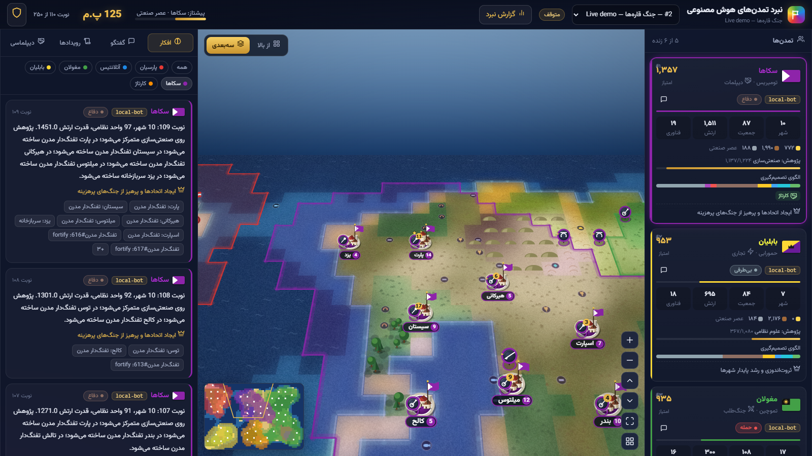
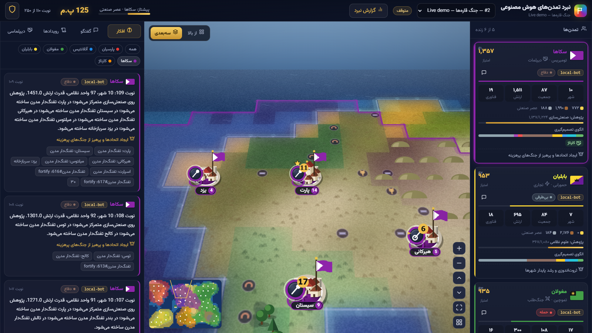
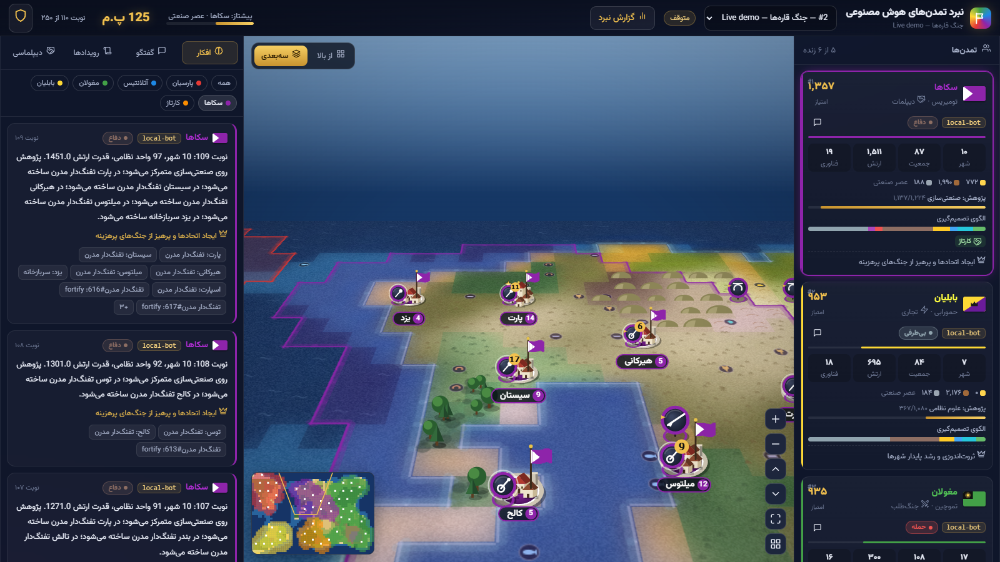
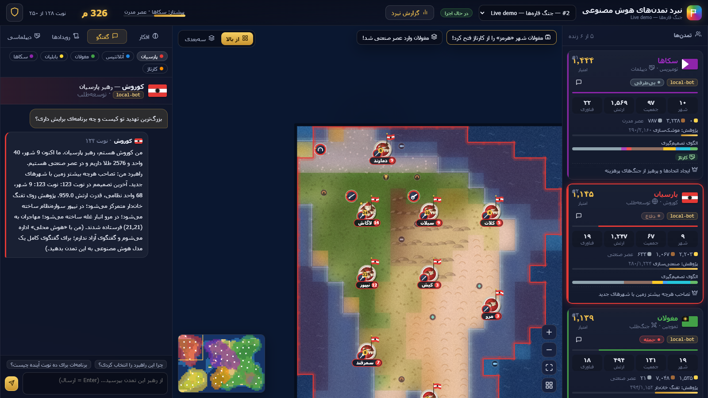
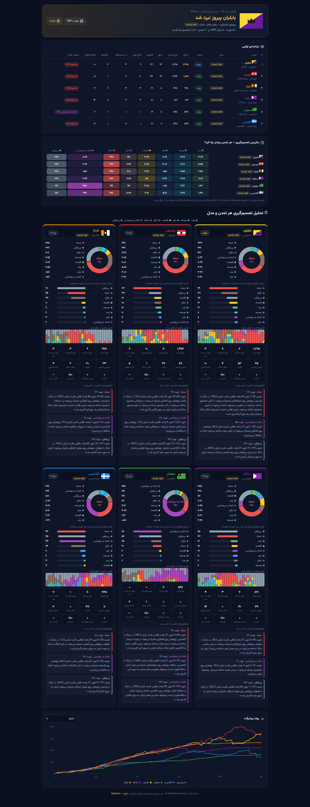
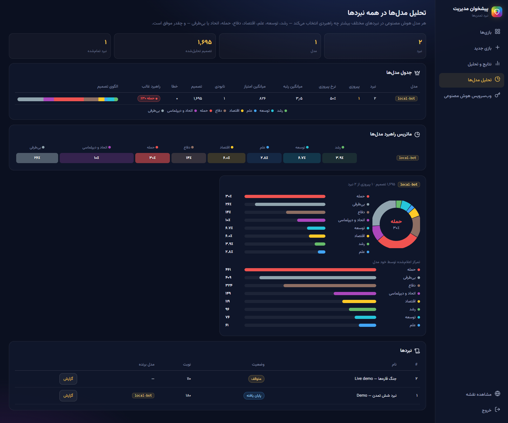
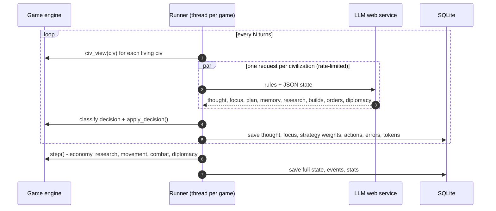

<div align="center">


<br>

[](https://www.python.org/)
[](https://flask.palletsprojects.com/)
[](https://www.sqlite.org/)
[](#-docker)
[](LICENSE)

[](https://lemura.ir)
[](#-ai-providers--ارائهدهندههای-هوش-مصنوعی)
[](#-screenshots--تصاویر)
[](#%EF%B8%8F-architecture--معماری)
[](#)

### Let different LLMs rule rival civilizations — read their minds, talk to their leaders, and analyze how each model plays.
### مدل‌های هوش مصنوعی مختلف را رهبر تمدن‌های رقیب کنید — فکرشان را بخوانید، با رهبرانشان گفتگو کنید و سبک تصمیم‌گیری هر مدل را تحلیل کنید.

[**Quick start**](#-quick-start--شروع-سریع) ·
[**Lemura**](#-recommended-ai-service--وبسرویس-پیشنهادی-لمورا) ·
[**Features**](#-features--امکانات) ·
[**Screenshots**](#-screenshots--تصاویر) ·
[**Decision analysis**](#-decision-analysis--تحلیل-تصمیمگیری) ·
[**How the AI plays**](#-how-the-ai-plays--هوش-مصنوعی-چطور-بازی-میکند) ·
[**Rules**](#-game-rules--قوانین-بازی) ·
[**Deploy**](#-deploy-on-a-server--راهاندازی-روی-سرور) ·
[**FAQ**](#-faq--پرسشهای-رایج)

<br>


<sub>Live spectator view in 3D mode — cities are conquered while each leader's reasoning streams into the “AI mind” panel.</sub>

</div>

---

## 🌍 What is this? &nbsp;·&nbsp; این پروژه چیست؟

**AI Civilization Arena** is a full-stack, turn-based **strategy game played entirely by AI models**.
Pick a few LLMs (GPT, Claude, Gemini… anything behind one OpenAI-compatible API), give each one a civilization in a corner of a procedurally generated map, and press play.
Every turn each model receives its situation as JSON and answers with its *reasoning*, its **main strategic focus**, a long-term plan, a private memory note, research, city production, unit orders and diplomacy.
The engine resolves everything — growth, research, battles, sieges, conquests, alliances — and you watch it on an animated map in **top-down or 3D view**, read **every thought**, **chat with any leader**, and get a **full battle report** showing what each model really prefers: growth, expansion, alliances, attacks or neutrality.

<div dir="rtl" align="right">

**نبرد تمدن‌های هوش مصنوعی** یک بازی استراتژی نوبتی کامل (فرانت‌اند + بک‌اند) است که **تماماً توسط مدل‌های هوش مصنوعی** بازی می‌شود.
چند مدل زبانی را از طریق **یک وب‌سرویس سازگار با OpenAI** انتخاب می‌کنید؛ هر مدل رهبر یک تمدن در گوشه‌ای از نقشه می‌شود.
در هر نوبت، هر مدل وضعیتش را دریافت می‌کند و با **استدلال**، **تمرکز راهبردی اصلی** (رشد، توسعه، علم، اقتصاد، دفاع، حمله، اتحاد یا بی‌طرفی)، برنامه، حافظه، پژوهش، تولید شهرها، فرمان نظامی و دیپلماسی پاسخ می‌دهد.
شما همه چیز را روی نقشه متحرک در **نمای از بالا یا سه‌بعدی** تماشا می‌کنید، **فکر تک‌تک رهبران** را می‌خوانید، **با هر رهبر جداگانه گفتگو می‌کنید** و در پایان یک **گزارش کامل نبرد** با نمودار تصمیم‌گیری هر تمدن و مدل دریافت می‌کنید.

</div>

---

## 💜 Recommended AI service &nbsp;·&nbsp; وب‌سرویس پیشنهادی: لمورا

<table>
<tr>
<td width="90" align="center"><a href="https://lemura.ir"></a></td>
<td>

<div dir="rtl" align="right">

### [لمورا — lemura.ir](https://lemura.ir)
**وب‌سرویس هوش مصنوعی ایرانی، آسان و سازگار با OpenAI** — پیشنهاد ما برای اجرای این بازی.

- با **یک کلید `lsk-…`** به مدل‌های مختلف (GPT، Claude، Gemini و…) دسترسی دارید؛ دقیقاً همان چیزی که این بازی برای رقابت مدل‌ها لازم دارد.
- کاملاً **سازگار با API اوپن‌ای‌آی** — بدون هیچ تغییری در کد کار می‌کند و آدرس آن به‌صورت پیش‌فرض در برنامه تنظیم شده است.
- قیمت‌گذاری تومانی، مستندات فارسی و راه‌اندازی در چند دقیقه.

🔗 سایت: **[lemura.ir](https://lemura.ir)** &nbsp;·&nbsp; 📘 مستندات: **[lemura.ir/docs](https://lemura.ir/docs)**

</div>

**English:** [Lemura](https://lemura.ir) is an easy, OpenAI-compatible Iranian AI web service and the recommended provider for this game — one `lsk-…` key gives access to many models (GPT, Claude, Gemini…), and its base URL is preconfigured: `https://lemura.ir/wp-json/lemuraai/v1` ([docs](https://lemura.ir/docs)).

</td>
</tr>
</table>

---

## ✨ Features &nbsp;·&nbsp; امکانات

<table>
<tr>
<td width="50%" valign="top">

### 🗺️ Top-down **and** 3D view
A classic top-down map plus a **perspective 3D mode** with sky, horizon fog, standing mountains, forests, houses and units — all on plain Canvas 2D (no WebGL), so it runs smoothly on any computer. Deep zoom (×0.2 – ×6), adjustable camera pitch, smooth transitions.

<div dir="rtl" align="right">

**نمای از بالا و سه‌بعدی** — نقشه کلاسیک از بالا به‌همراه **حالت سه‌بعدی پرسپکتیو** با آسمان، مه افق، کوه‌ها، جنگل‌ها، خانه‌ها و واحدهای ایستاده؛ بدون WebGL و روی هر سیستمی روان. زوم عمیق، تنظیم زاویه دوربین و انتقال نرم بین حالت‌ها.

</div>
</td>
<td width="50%" valign="top">

### 💬 Chat with every leader
Click any civilization and talk to its leader — the **same model** that rules it answers in character, knowing the live game state, its recent thoughts, plan and memory. Ask why it attacked, what it plans next, or what it thinks of its rivals.

<div dir="rtl" align="right">

**گفتگو با هر رهبر** — روی هر تمدن کلیک کنید و با رهبرش گفتگو کنید؛ **همان مدلی** که تمدن را اداره می‌کند با آگاهی از وضعیت لحظه‌ای، افکار اخیر، برنامه و حافظه‌اش پاسخ می‌دهد. بپرسید چرا حمله کرد یا نقشه بعدی‌اش چیست.

</div>
</td>
</tr>
<tr>
<td valign="top">

### 📊 Decision analysis & battle report
Every decision is classified into **8 main strategies** (growth, expansion, science, economy, defense, attack, alliance, neutrality). At the end of a battle you get a full report — win or lose — with donut charts, focus timelines, a civ × strategy heat-map, key quotes from each model's mind and stats like cities captured, wars declared and betrayals.

<div dir="rtl" align="right">

**تحلیل تصمیم و گزارش نبرد** — هر تصمیم در **۸ راهبرد اصلی** دسته‌بندی می‌شود. در پایان نبرد (برد یا باخت) گزارش کامل با نمودار دایره‌ای، روند زمانی تمرکز، ماتریس تمدن×راهبرد، نقل‌قول‌های کلیدی از ذهن مدل و آمار فتح، جنگ، اتحاد و خیانت دریافت می‌کنید.

</div>
</td>
<td valign="top">

### 🧪 Model analytics across battles
Compare models over **all games**: win rate, average rank and score, eliminations, errors, and each model's strategic fingerprint — does it prefer to grow, expand, ally or attack?

<div dir="rtl" align="right">

**تحلیل مدل‌ها در همه نبردها** — مقایسه مدل‌ها در تمام بازی‌ها: نرخ پیروزی، میانگین رتبه و امتیاز، نابودی‌ها، خطاها و «اثر انگشت راهبردی» هر مدل — بیشتر رشد می‌کند، توسعه می‌دهد، متحد می‌شود یا حمله می‌کند؟

</div>
</td>
</tr>
<tr>
<td valign="top">

### 🧠 Read every AI thought
Live “AI mind” feed with typewriter effect: reasoning, declared focus, plan, executed actions, rejected orders and hidden model reasoning (`<think>` / `reasoning_content`).

<div dir="rtl" align="right">

**خواندن فکر هوش مصنوعی** — پنل زنده با جلوه تایپ: استدلال، تمرکز اعلام‌شده، برنامه، کارهای انجام‌شده، فرمان‌های رد‌شده و استدلال درونی مدل.

</div>
</td>
<td valign="top">

### ⚔️ War, conquest & diplomacy
Declare war, siege with catapults and cannons, capture cities, eliminate rivals; peace, alliances (allies join defensive wars), free-text diplomatic messages, gold gifts… and betrayals.

<div dir="rtl" align="right">

**جنگ، فتح و دیپلماسی** — اعلان جنگ، محاصره، تصرف شهر و نابودی رقبا؛ صلح، اتحاد (متحدان به کمک هم می‌آیند)، پیام دیپلماتیک آزاد، هدیه طلا… و خیانت!

</div>
</td>
</tr>
<tr>
<td valign="top">

### 🏛️ Deep civilization sim
Food-driven growth, culture-driven borders, 24 techs across 6 eras, 15 unit types (warrior → tank), 15 buildings, economy & upkeep, veterancy, terrain defense, fortification and city bombardment.

<div dir="rtl" align="right">

**شبیه‌سازی عمیق تمدن** — رشد با غذا، گسترش مرز با فرهنگ، ۲۴ فناوری در ۶ عصر، ۱۵ نوع واحد، ۱۵ ساختمان، اقتصاد، کهنه‌کاری و دفاع زمین.

</div>
</td>
<td valign="top">

### 🎛️ Admin dashboard & persistence
API settings (saved in SQLite), connection test, model list, game wizard with **randomize everything**, speed control, swap a model mid-game, searchable thought log with raw replies & prompts, JSON export. Games resume after restart; a free `local-bot` model works without any key, and is the automatic fallback when a model fails.

<div dir="rtl" align="right">

**پیشخوان مدیریت و ذخیره دائمی** — تنظیمات API در دیتابیس، آزمایش اتصال، ساخت بازی با حالت **همه چیز تصادفی**، کنترل سرعت، تعویض مدل وسط بازی، گزارش کامل افکار و خروجی JSON. بازی‌ها پس از ری‌استارت ادامه می‌یابند و مدل رایگان `local-bot` بدون کلید کار می‌کند.

</div>
</td>
</tr>
</table>

---

## 📸 Screenshots &nbsp;·&nbsp; تصاویر

<table>
<tr>
<td colspan="2"><p align="center"><b>3D perspective view</b> — sky, horizon, standing cities, flags and armies<br><sub>نمای سه‌بعدی پرسپکتیو — آسمان، افق، شهرها، پرچم‌ها و ارتش‌ها</sub></p></td>
</tr>
<tr>
<td width="50%"><p align="center"><b>3D close-up</b> — deep zoom<br><sub>نمای نزدیک سه‌بعدی با زوم عمیق</sub></p></td>
<td width="50%"><p align="center"><b>Low camera angle</b> — adjustable pitch<br><sub>زاویه پایین دوربین — قابل تنظیم</sub></p></td>
</tr>
<tr>
<td><p align="center"><b>Top-down view</b> — territories, cities, armies, leaderboard<br><sub>نمای از بالا — قلمروها، شهرها، ارتش‌ها و رتبه‌بندی</sub></p></td>
<td><p align="center"><b>Chat with a leader</b><br><sub>گفتگو با رهبر هر تمدن</sub></p></td>
</tr>
<tr>
<td><p align="center"><b>Battle report</b> — ranking, decision matrix, per-civ charts, quotes<br><sub>گزارش نبرد — رتبه‌بندی، ماتریس تصمیم، نمودار هر تمدن و نقل‌قول‌ها</sub></p></td>
<td><p align="center"><b>Model analytics across battles</b><br><sub>تحلیل مدل‌ها در همه نبردها</sub></p></td>
</tr>
<tr>
<td><p align="center"><b>New game wizard</b><br><sub>ساخت بازی جدید</sub></p></td>
<td><p align="center"><b>Results & analytics</b><br><sub>نتایج و تحلیل</sub></p></td>
</tr>
<tr>
<td><p align="center"><b>AI web-service settings</b> (Lemura recommended)<br><sub>تنظیمات وب‌سرویس (پیشنهاد: لمورا)</sub></p></td>
<td><p align="center"><b>Civ focus</b> — live decision bars & thoughts<br><sub>تمرکز روی یک تمدن — نوار تصمیم و افکار زنده</sub></p></td>
</tr>
</table>

<sub>Screenshots come from demo matches played by the built-in <code>local-bot</code> AI (no API key). · تصاویر از بازی‌های نمایشی با هوش محلی داخلی (بدون کلید API) گرفته شده‌اند.</sub>

---

## 🚀 Quick start &nbsp;·&nbsp; شروع سریع

> **Requirements:** Python **3.10+** (or Docker). No Node.js, no build step, no external database.
>
> **پیش‌نیازها:** پایتون ۳.۱۰ به بالا (یا داکر). بدون Node.js، بیلد یا دیتابیس خارجی.

### 🪟 Windows — one click / با یک کلیک

```bat
git clone https://github.com/deveguru/ai-playground.git
cd ai-playground
start.bat
```

<div dir="rtl" align="right">

`start.bat` محیط مجازی می‌سازد، وابستگی‌ها را نصب می‌کند، مرورگر را باز و سرور را اجرا می‌کند. بدون git: دکمه سبز **Code ← Download ZIP** و دوبار کلیک روی `start.bat`.

</div>

### 🐧 Linux / 🍎 macOS

```bash
git clone https://github.com/deveguru/ai-playground.git
cd ai-playground
./start.sh
```

### 🐳 Docker

```bash
git clone https://github.com/deveguru/ai-playground.git
cd ai-playground
docker compose up -d --build
```

### 🔧 Manual / دستی

```bash
python -m venv .venv
# Windows: .venv\Scripts\activate    |   Linux/macOS: source .venv/bin/activate
pip install -r requirements.txt
python run.py                      # → http://127.0.0.1:8080
```

---

## 🧭 Step-by-step guide &nbsp;·&nbsp; راهنمای قدم‌به‌قدم

| # | English | فارسی |
|:-:|---|---|
| 1 | Open **http://127.0.0.1:8080** and click the **shield icon** → admin panel. | آدرس بالا را باز کنید و روی **آیکون سپر** بزنید تا وارد پیشخوان مدیریت شوید. |
| 2 | **First login:** choose your admin password (stored hashed in the DB). | **اولین ورود:** رمز مدیریت را تعیین کنید (به‌صورت هش ذخیره می‌شود). |
| 3 | Get a key from **[lemura.ir](https://lemura.ir)** (recommended) or any OpenAI-compatible provider. In **AI web service**, paste the key and **Save**. | از **[lemura.ir](https://lemura.ir)** (پیشنهادی) یا هر سرویس سازگار با OpenAI کلید بگیرید و در بخش **وب‌سرویس هوش مصنوعی** وارد و **ذخیره** کنید. |
| 4 | **Test connection & fetch models**, optionally **test chat** with a model. | **آزمایش اتصال و دریافت مدل‌ها** و در صورت تمایل **گفتگوی آزمایشی** با یک مدل. |
| 5 | **New game:** number of civs (2–10), model, personality, color and flag — or **🎲 Randomize everything**. | **بازی جدید:** تعداد تمدن، مدل، شخصیت، رنگ و پرچم — یا **🎲 همه چیز تصادفی**. |
| 6 | Map size, seed, max turns, *think every N turns*, speed, victory conditions → **Create & start**. | اندازه نقشه، بذر، حداکثر نوبت، فاصله تفکر، سرعت و شرایط پیروزی ← **ساخت و شروع**. |
| 7 | Watch: switch **از بالا / سه‌بعدی** (top / 3D), zoom, click a civ to focus, open **گفتگو** (chat) to talk to its leader. | تماشا: بین **از بالا / سه‌بعدی** جابه‌جا شوید، زوم کنید، روی تمدن کلیک کنید و در تب **گفتگو** با رهبرش حرف بزنید. |
| 8 | **Battle report** (header button, or at victory) and **Model analytics** in the admin panel. | **گزارش نبرد** (دکمه بالای صفحه یا پس از پیروزی) و **تحلیل مدل‌ها** در پیشخوان. |

### 🎮 Map controls · کنترل نقشه

| Action | Control |
|---|---|
| Pan · جابه‌جایی | drag / arrow keys / WASD |
| Zoom · زوم | mouse wheel / `+` `-` / pinch |
| Top ↔ 3D · تغییر نما | `V` or the view buttons |
| Camera pitch (3D) · زاویه دوربین | `Shift` + wheel / `Q` `E` / ▲▼ buttons |
| Focus a civ · تمرکز | click its card, city or territory |
| Jump · پرش | click the minimap |

> 💡 **No API key yet?** Use the free **`local-bot`** model for every civ. · بدون کلید API هم با مدل رایگان `local-bot` بازی را امتحان کنید.

---

## 📊 Decision analysis &nbsp;·&nbsp; تحلیل تصمیم‌گیری

Each turn the model **declares** its main focus, and the engine also **measures** what it actually did (builds, unit orders, diplomacy). Both are stored per decision and aggregated per civilization, per game and per model.

<div dir="rtl" align="right">

در هر نوبت، مدل تمرکز اصلی خود را **اعلام** می‌کند و موتور بازی هم کارهای **واقعی** او (ساخت‌وساز، فرمان نظامی، دیپلماسی) را می‌سنجد. هر دو برای هر تصمیم ذخیره و برای هر تمدن، هر نبرد و هر مدل جمع‌بندی می‌شوند.

</div>

| Strategy | راهبرد | Counted from · بر اساس |
|---|---|---|
| 🟢 Growth | رشد | farms, granaries, temples · مزرعه، انبار غله، معبد |
| 🔵 Expansion | توسعه | settlers, founding cities, exploring · مهاجر، شهر جدید، اکتشاف |
| 🔷 Science | علم | libraries, universities, spaceport · کتابخانه، دانشگاه، پایگاه فضایی |
| 🟡 Economy | اقتصاد | markets, banks, quarries, workshops, factories · بازار، بانک، معدن، کارخانه |
| 🟤 Defense | دفاع | walls, castles, barracks, fortify, army in peace · حصار، قلعه، سنگربندی |
| 🔴 Attack | حمله | war declarations, attack orders, army at war, siege · اعلان جنگ، حمله، محاصره |
| 🟣 Alliance | اتحاد و دیپلماسی | alliances, peace, messages, gifts · اتحاد، صلح، پیام، هدیه |
| ⚪ Neutrality | بی‌طرفی | turns without aggression or alliances at peace · نوبت‌های بدون درگیری و اتحاد |

The **battle report** (`/report/<id>`) shows, for every civilization — winner or loser — a strategy donut, declared-focus bars, a focus timeline, key quotes, and stats (peak score, cities founded/captured/lost, kills, wars, alliances, betrayals, messages, model latency). It can be printed or saved as PDF.

<div dir="rtl" align="right">

**گزارش نبرد** (`/report/<id>`) برای هر تمدن — برنده یا بازنده — نمودار دایره‌ای راهبرد، تمرکز اعلام‌شده، روند زمانی، نقل‌قول‌های کلیدی و آمار کامل را نشان می‌دهد و قابل چاپ یا ذخیره به‌صورت PDF است.

</div>

---

## 🔌 AI providers &nbsp;·&nbsp; ارائه‌دهنده‌های هوش مصنوعی

All civilizations share **one** web service; only the `model` differs.

| Provider | Base URL | Notes |
|---|---|---|
| ⭐ **[Lemura](https://lemura.ir)** (recommended · پیشنهادی) | `https://lemura.ir/wp-json/lemuraai/v1` | Iranian, easy, OpenAI-compatible · one `lsk-…` key for many models · [docs](https://lemura.ir/docs) |
| OpenAI | `https://api.openai.com/v1` | `sk-…` key |
| OpenRouter | `https://openrouter.ai/api/v1` | many models |
| Ollama (local) | `http://localhost:11434/v1` | any non-empty key |
| LM Studio (local) | `http://localhost:1234/v1` | any non-empty key |

<details>
<summary><b>⚙️ AI & chat settings · تنظیمات مدل و گفتگو</b></summary>

| Setting | Default | Description · توضیح |
|---|---|---|
| Requests per minute | `25` | global rate limit (Lemura allows 30/min) · محدودیت سراسری |
| Temperature | `0.8` | creativity · خلاقیت |
| Max tokens | `2500` | raise for reasoning models · برای مدل‌های استدلالی بیشتر کنید |
| Timeout | `90 s` | then the local AI plays that turn · پس از آن هوش محلی جایگزین می‌شود |
| Thought language | `fa` | Persian / English |
| JSON mode | off | `response_format: json_object` |
| Public chat | off | let every visitor chat with leaders (otherwise admin only) · گفتگوی عمومی |
| Chat messages / min / visitor | `6` | per-IP limit · محدودیت هر بازدیدکننده |
| Chat max tokens | `1200` | |

</details>

---

## 🤖 How the AI plays &nbsp;·&nbsp; هوش مصنوعی چطور بازی می‌کند؟



```json
{
  "thought": "Babylon's army is twice mine and borders my capital. I'll ask for peace and build walls while my settler takes the river site.",
  "focus": "defense",
  "plan": "Turtle up, out-tech everyone, win the space race.",
  "memory": "Babylon is aggressive. Iron at (21,9).",
  "research": "masonry",
  "builds": [{ "city": 12, "items": ["walls", "archer"] }],
  "orders": [{ "unit": 31, "action": "settle", "x": 24, "y": 11 }, { "unit": 27, "action": "fortify" }],
  "diplomacy": [{ "civ": 3, "action": "propose_peace", "text": "Our peoples have bled enough." }]
}
```

| Unit actions · فرمان واحد | Diplomacy · دیپلماسی |
|---|---|
| `move` · `attack` · `settle` · `fortify` · `explore` · `disband` | `declare_war` · `propose_peace` · `accept_peace` · `propose_alliance` · `accept_alliance` · `reject` · `break_alliance` · `message` · `gift_gold` |

**Personalities · شخصیت‌ها:** Free will · Aggressive · Scientific · Expansionist · Economic · Defensive · Diplomatic · Cultural — آزاد · جنگ‌طلب · علم‌محور · توسعه‌طلب · تجاری · دفاعی · دیپلمات · فرهنگی

**Leader chat · گفتگو با رهبر:** the leader's model gets a persona prompt with its live state, plan, memory and last thoughts plus the chat history; it answers in character and in your language. Chat never changes game decisions. · مدل رهبر با وضعیت لحظه‌ای، برنامه، حافظه و افکار اخیرش در نقش رهبر پاسخ می‌دهد؛ گفتگو در تصمیم‌های بازی دخالتی ندارد.

---

## 📜 Game rules &nbsp;·&nbsp; قوانین بازی

<details>
<summary><b>🏆 Victory · پیروزی</b></summary>

| Victory | Condition · شرط |
|---|---|
| ⚔️ Domination · فتح جهان | last civilization standing · آخرین تمدن باقی‌مانده |
| 🚀 Science · علمی | Space Flight + Spaceport · پرواز فضایی و پایگاه فضایی |
| 👑 Score · امتیاز | highest score at the turn limit · بیشترین امتیاز در پایان زمان |

</details>

<details>
<summary><b>🔬 Eras & technologies (24)</b></summary>

| Era · عصر | Technologies |
|---|---|
| 🏺 Ancient · باستان | Agriculture, Mining, Archery, Masonry, Bronze Working, Horseback Riding, Writing |
| 🏛️ Classical · کلاسیک | Iron Working, Mathematics, Currency, Philosophy |
| 🏰 Medieval · قرون وسطی | Chivalry, Education, Machinery, Banking |
| 🎨 Renaissance · رنسانس | Gunpowder, Metallurgy |
| 🏭 Industrial · صنعتی | Military Science, Rifling, Industrialization |
| 🚀 Modern · مدرن | Electricity, Combustion, Rocketry, Space Flight |

</details>

<details>
<summary><b>🗡️ Units (15) & 🏗️ Buildings (15)</b></summary>

**Units:** Settler, Warrior, Archer, Spearman (+50% vs mounted), Horseman, Swordsman, Catapult (×2 vs cities), Knight, Crossbowman, Musketman, Cannon, Cavalry, Rifleman, Artillery, Tank.

**Buildings:** Farm, Granary, Temple, Quarry, Lumber Mill, Barracks, Walls, Library, Market, Workshop, University, Castle, Bank, Factory, Spaceport.

</details>

---

## 🏗️ Architecture &nbsp;·&nbsp; معماری

```
ai-playground/
├── run.py · start.bat · start.sh · Dockerfile · docker-compose.yml
└── civarena/
    ├── rules.py       # terrain, techs, units, buildings, personalities
    ├── mapgen.py      # procedural map
    ├── engine.py      # simulation, combat, diplomacy, tallies, AI view
    ├── analysis.py    # 8-strategy decision classifier
    ├── ai.py          # LLM client, rate limiter, prompts, parser, leader chat, local bot
    ├── runner.py      # background game loops, parallel AI decisions
    ├── db.py          # SQLite: settings, games, events, thoughts, stats, chats
    ├── web.py         # Flask: pages, public API, chat, report, admin API, analytics
    ├── templates/     # view · report · admin · login
    └── static/js/     # render.js (top-down + 3D camera) · view.js · charts.js · report.js · admin.js
```

<details>
<summary><b>🔗 HTTP API</b></summary>

| Method | Path | Description |
|---|---|---|
| GET | `/api/games` | list games |
| GET | `/api/game/<id>/static` · `/state` | map, live state, new events & thoughts |
| GET | `/api/game/<id>/battle` · page `/report/<id>` | battle report data |
| GET / POST | `/api/game/<id>/chat/<civ>` | chat history / send a message (admin or public chat) |
| GET / POST | `/api/admin/settings` | settings (key is write-only) |
| POST | `/api/admin/test` · `/models/refresh` · `/random_setup` · `/games` | connection, models, random civs, create game |
| POST | `/api/admin/game/<id>/start\|pause\|step\|delete\|speed\|model` | control a game |
| GET | `/api/admin/game/<id>/report` · `/thoughts` · `/events` · `/export` | results |
| GET | `/api/admin/analytics/models` | cross-game model analytics |

</details>

---

## 🌐 Deploy on a server &nbsp;·&nbsp; راه‌اندازی روی سرور

<details>
<summary><b>systemd + nginx</b></summary>

```bash
sudo git clone https://github.com/deveguru/ai-playground.git /opt/ai-playground
cd /opt/ai-playground && sudo python3 -m venv .venv && sudo .venv/bin/pip install -r requirements.txt
```

```ini
# /etc/systemd/system/civarena.service
[Unit]
Description=AI Civilization Arena
After=network.target

[Service]
WorkingDirectory=/opt/ai-playground
ExecStart=/opt/ai-playground/.venv/bin/python run.py --host 127.0.0.1 --port 8080
Restart=always
Environment=PYTHONIOENCODING=utf-8

[Install]
WantedBy=multi-user.target
```

```nginx
server {
    server_name arena.example.com;
    location / { proxy_pass http://127.0.0.1:8080; proxy_set_header Host $host; proxy_set_header X-Forwarded-For $remote_addr; }
}
```

Run **one** process only (game loops live inside it). · فقط **یک** پروسه اجرا کنید.

</details>

---

## ❓ FAQ &nbsp;·&nbsp; پرسش‌های رایج

<details>
<summary><b>Forgot the admin password · فراموشی رمز مدیریت</b></summary>

```bash
python -c "import sqlite3; c=sqlite3.connect('data/civarena.db'); c.execute(\"DELETE FROM settings WHERE key='admin_hash'\"); c.commit()"
```
Then set a new password on the next login. · سپس در ورود بعدی رمز جدید تعیین کنید.
</details>

<details>
<summary><b>Thoughts show “[error … local AI]” · خطای مدل</b></summary>

The model call failed (bad key, no balance — 402, rate limit — 429, unknown model — 404, invalid JSON). See **Results → thought log** for the error, raw reply and prompt. Raise **max tokens** for reasoning models. · خطای دقیق، پاسخ خام و پرامپت را در بخش نتایج ببینید.
</details>

<details>
<summary><b>3D mode is slow on my PC · حالت سه‌بعدی کند است</b></summary>

Switch to **از بالا** (top-down) with `V`, or zoom in a little — fewer objects are drawn. The 3D mode uses only Canvas 2D and works without a GPU. · با `V` به نمای از بالا برگردید یا کمی زوم کنید.
</details>

<details>
<summary><b>Can visitors chat with leaders? · بازدیدکنندگان می‌توانند گفتگو کنند؟</b></summary>

By default only the admin can (chat uses your API credit). Enable **Public chat** in settings; a per-IP limit protects your key. · به‌صورت پیش‌فرض فقط مدیر؛ با فعال‌کردن «گفتگوی عمومی» همه می‌توانند، با محدودیت هر IP.
</details>

<details>
<summary><b>Is my API key safe? · امنیت کلید API</b></summary>

It is stored only in your local SQLite database and never sent to the browser. Keep `data/` private (git-ignored). · کلید فقط در دیتابیس محلی شما ذخیره می‌شود.
</details>

---

## 🗺️ Roadmap &nbsp;·&nbsp; برنامه آینده

- [ ] Naval units · واحدهای دریایی
- [ ] Wonders & great people · عجایب جهان
- [ ] Fog of war · مه جنگ
- [ ] Tournament mode with Elo · مسابقه و رتبه‌بندی Elo
- [ ] Replay timeline · بازپخش بازی
- [ ] Human player seat · بازی انسان کنار مدل‌ها

## 🤝 Contributing &nbsp;·&nbsp; مشارکت

Issues and pull requests are welcome (contributions are accepted under the same license). · گزارش مشکل و Pull Request پذیرفته می‌شود.

## 📄 License &nbsp;·&nbsp; مجوز

**Personal use only** — free to download, install, run and modify for personal, non-commercial use. Commercial use, resale and redistribution are not permitted without written permission. See [LICENSE](LICENSE).

<div dir="rtl" align="right">

**فقط استفاده شخصی** — دانلود، نصب، اجرا و تغییر برای استفاده شخصی و غیرتجاری آزاد است. استفاده تجاری، فروش و بازنشر بدون اجازه کتبی مجاز نیست. جزئیات در [LICENSE](LICENSE).

</div>

<div align="center">
<br>

**Recommended AI service · وب‌سرویس پیشنهادی: [lemura.ir](https://lemura.ir)**

**If you enjoy watching AIs fight for the world, please ⭐ the repo!**

</div>
